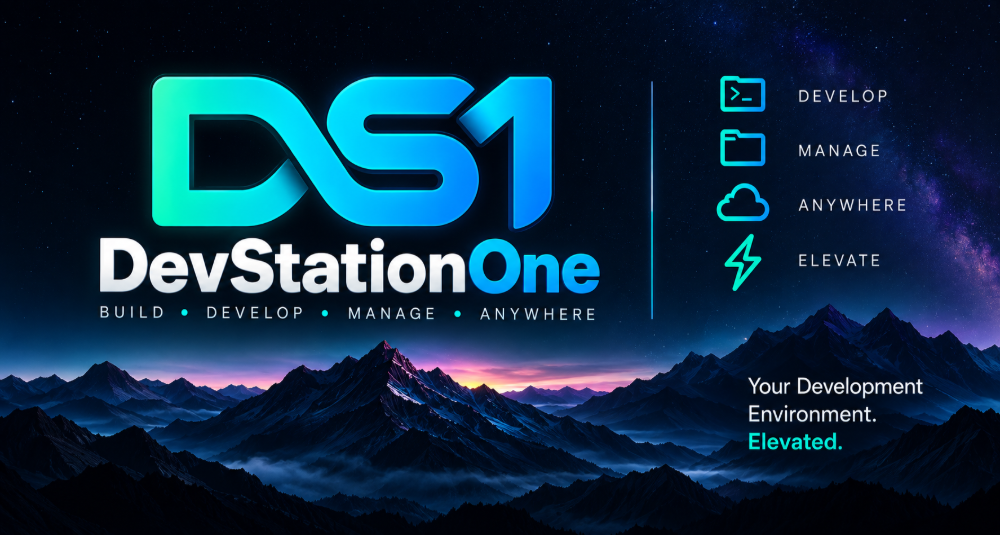

<p align="center">
  
</p>

<h1 align="center">DevStationOne</h1>

<p align="center">
  <strong>Close the laptop. Your dev environment keeps running.</strong><br>
  Every machine you code on, in one browser tab. Self-hosted, with zero inbound ports.
</p>

---

Your code lives on a laptop, a homelab box, a GPU rig, a cloud VM. Reaching each one means SSH sessions, tmux, port forwards, and a VPN you hope is up. DevStationOne replaces all of it with one private URL.

Run a **Control Server** on hardware you own, and drop a small **Runtime** agent on each dev machine. The agent dials out to your server, and from then on any browser or your phone opens that machine as a full workspace: the shell, the dev server, and the Claude Code session you left running are all still there. Terminals are real PTYs that outlive your browser, so you reattach instead of restarting.

- **Sessions that never die.** Lose Wi-Fi, switch devices, come back tomorrow, and pick up mid-command.
- **Nothing to open on the firewall.** Runtimes connect out, so NAT, CGNAT, and home routers just work.
- **More than a shell.** Files, an editor, Git, four database engines, Docker, and systemd services sit beside your terminals in the same project tab.
- **Your hardware, your data.** No vendor relay and no hosted account. The server and its PostgreSQL run where you put them.
- **Built for AI CLIs.** Claude Code and friends run as ordinary processes in the project directory, so `CLAUDE.md`, skills, and MCP config just work.
- **API-first.** Everything the UI does is a documented REST/WebSocket call, so you can script it.

## What you get

Each **Project** (a runtime + OS user + working directory + shell) opens as one tabbed workspace:

| Tab | What it does |
|---|---|
| Terminal | Real PTYs, multiple per project. Sessions survive browser disconnects and can be reattached. Quick Commands for repeatable runs. |
| Files | List, read, edit, upload, download, rename, copy, move, delete, search. Containment enforced on the runtime itself. |
| Code | In-browser editor over the project's files. |
| Source Control | Git status, diff, stage, commit, amend, branches, log, pull, push. |
| Databases | PostgreSQL, MySQL/MariaDB, SQL Server, SQLite: schema browser, data editor, SQL editor, users/roles where the engine has them, backups. |
| Docker | Containers, images, and Compose projects on the runtime host. |
| Journal | Per-project notes with attachments and commit metadata. |

Runtime-level pages cover `systemd --user` services, runtime enrollment and revocation, user management, and an activity log.

Claude Code and other AI CLIs need no special integration. A terminal starts in the project directory as the project user, so project-local `CLAUDE.md`, `.claude/`, and MCP config are picked up as usual.

Everything the web UI does goes through the OpenAPI-described API at `/api/v1` ([docs/openapi.yaml](docs/openapi.yaml)).

## Take it anywhere

One server, every screen. Your workspaces follow you, and so do your running sessions.

| Client | Status | Why you'll want it |
|---|---|---|
| **Browser** | Available | Nothing to install. Open your server's URL on any laptop, tablet, or borrowed machine. Install it as an app from Chrome, Edge, or Safari for a standalone window and a home-screen icon, and turn on push alerts to hear about finished tasks and waiting prompts with the tab closed. |
| **Android** | Available | A native app, not a shrunken website: real terminals, journal, source control, and databases in your pocket. Each phone is paired and signs every request with a key that never leaves the device. See [docs/ANDROID_CLIENT.md](docs/ANDROID_CLIENT.md). |
| **Windows desktop** | Coming soon | A native client with a system tray icon, OS notifications, and real file downloads. Everything the web app does, plus the three things a browser tab can't. |
| **macOS desktop** | Coming soon | The same tray, notification, and download integration as a native Mac app. |
| **Linux desktop** | Coming soon | A native client for the platform most of your dev machines already run: tray, notifications, and downloads that land where you expect. |

Every client talks to the same documented API, so a session started on your desktop is waiting on your phone.

## How it works

```text
 Browser / Android client
      │  HTTPS + WebSocket
      ▼
 Control Server ── PostgreSQL            (VPS, homelab box, or VM)
      ▲
      │  outbound WebSocket (runtime dials in)
      │
 Development Runtime                     (one per dev machine, normal user, never root)
      ├── PTY sessions
      ├── Filesystem
      ├── systemd --user services
      ├── Docker
      └── Database connections
```

- **Control Server**: Go binary with the REST API, auth, WebSocket gateway, and embedded web UI. State lives in PostgreSQL.
- **Development Runtime**: Go binary run as your normal user. Opens a single authenticated outbound connection and executes PTY, file, service, Docker, and database operations locally.

## Security model

- Login requires **2FA**: TOTP or passkeys. Optional Cloudflare Turnstile on the login form.
- **Single-tenant trust model** (ADR-054): accounts are created by an administrator, and every account can reach every project and therefore run code as the runtime user on every runtime. Only create accounts for people you would give a shell on those machines. Per-project membership is not implemented.
- The runtime never runs as root and enforces path containment and symlink safety independently of the server.
- Terminal I/O, file contents, credentials, and tokens are never logged.
- Terminate TLS in front of the server. See [docs/SECURITY.md](docs/SECURITY.md).

## Requirements

- **Control Server host:** Linux (amd64/arm64) with systemd.
- **PostgreSQL:** 14 or newer, reachable from the server only.
- **Dev machines:** Linux with `systemd --user`.
- **Browser:** current Chrome, Firefox, Edge, or Safari.

## Quick start

```bash
# 1. Control Server (on the server host)
curl -fsSL https://raw.githubusercontent.com/Dev-Station-One/DevStationOne/main/install.sh | sudo bash -s -- --server
sudoedit /etc/devstationone/server.env        # set DEVSTATIONONE_DATABASE_URL
sudo systemctl enable --now devstationone-server

# 2. First administrator
set -a; source /etc/devstationone/server.env; set +a
echo 'a-strong-password' | devstationone-admin --email you@example.com

# 3. Runtime (on each dev machine, as your normal user)
curl -fsSL https://raw.githubusercontent.com/Dev-Station-One/DevStationOne/main/install.sh | bash -s -- --runtime
```

Then:

1. Log in to the web UI and complete 2FA enrollment.
2. **Runtimes → Add runtime**, and copy the enrollment token (shown once).
3. On the dev machine, put `DEVSTATIONONE_SERVER_URL` and `DEVSTATIONONE_RUNTIME_TOKEN` in `~/.config/devstationone/runtime.env`, then:
   ```bash
   systemctl --user enable --now devstationone-runtime
   loginctl enable-linger
   ```
4. **Projects → New project**, pick the runtime, user, working directory, and shell, and open a terminal.

The server needs a PostgreSQL database first (`CREATE ROLE` + `CREATE DATABASE`). Configuration variables, reverse proxy setup, upgrading, removal, and troubleshooting are in **[docs/DEPLOYMENT.md](docs/DEPLOYMENT.md)**. Back up the database and `DEVSTATIONONE_DB_ENCRYPTION_KEY` per [docs/BACKUPS.md](docs/BACKUPS.md).

## Building from source

Requires Go (version in `go.mod`) and Docker for the dev database.

```bash
git clone https://github.com/Dev-Station-One/DevStationOne.git
cd DevStationOne
make db-up        # dev PostgreSQL on localhost:55432
make build        # server, runtime, admin CLI
make test         # full suite (uses a separate test Postgres)
```

## Documentation

| Doc | Contents |
|---|---|
| [docs/DEPLOYMENT.md](docs/DEPLOYMENT.md) | Install, configuration, TLS proxy, upgrade, troubleshooting |
| [docs/PRD.md](docs/PRD.md) | Product requirements |
| [docs/ARCHITECTURE.md](docs/ARCHITECTURE.md) | System architecture |
| [docs/API.md](docs/API.md) · [docs/openapi.yaml](docs/openapi.yaml) | API reference and contract |
| [docs/PROTOCOL.md](docs/PROTOCOL.md) | Control↔runtime and terminal protocols |
| [docs/SECURITY.md](docs/SECURITY.md) | Security model |
| [docs/DECISIONS.md](docs/DECISIONS.md) | Architecture decision records |
| [docs/BACKUPS.md](docs/BACKUPS.md) | Backup and key handling |
| [docs/IMPLEMENTATION_PLAN.md](docs/IMPLEMENTATION_PLAN.md) | Roadmap and progress |

## License

[MIT](LICENSE). Copyright (c) 2026 Brian Tafoya.
